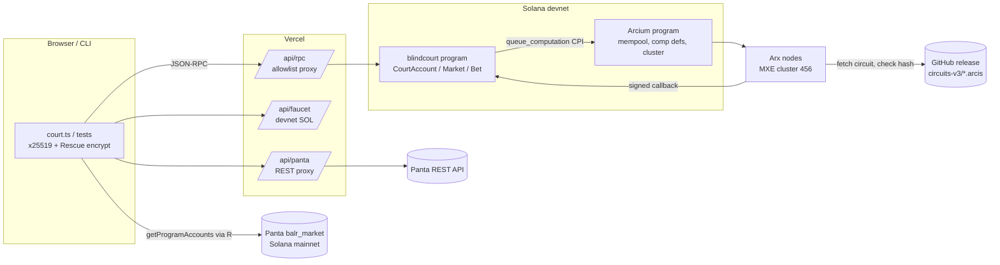

# Architecture

Saring (code name `blindcourt`) is a conflict-blind jury for prediction-market disputes. It has three layers:

1. **Arcis circuits** (`encrypted-ixs/src/lib.rs`), which run inside an Arcium MXE (multi-party computation).
2. **An Anchor program** (`programs/blindcourt/src/lib.rs`, v3.1) on Solana. It owns each court's encrypted state, queues the circuits, verifies their callbacks, and settles a small pari-mutuel market on the verdict.
3. **Off-chain clients**: the e2e test (`tests/blindcourt.ts`), the web app (`app/src/court.ts`), three Vercel functions (`app/api/*.js`), and the Panta reader (`panta/panta.ts`).

Deployed: program `3CeQ1DQYwXjNcr6hYwmACzUwyU1DNxWL9HtiCaVKyfHy` on Solana devnet, Arcium 0.15.0 MXE on devnet cluster offset 456. See [AUDIT_SCOPE.md](AUDIT_SCOPE.md) for versions and hashes, [THREAT_MODEL.md](THREAT_MODEL.md) for the adversary analysis and [SECURITY.md](SECURITY.md) for the review history.



## Components

### Arcis circuits (`encrypted-ixs/src/lib.rs`)

All five circuits share one encrypted state, `type Court = Pack<[u32; 73]>`, owned by the MXE (`Enc<Mxe, Court>`). Constants: `H = 48` holder slots, `J = 8` juror slots, `B = 6` ids per `record_positions_v3` call, `F = H + 3J = 72` (overflow flag index).

**Logical slot map** (index into the 73 `u32`s):

| Index range | Count | Meaning | Empty value |
|---|---|---|---|
| `0 ..= 47` (`[0, H)`) | 48 | Position-holder ids | `0` |
| `48 ..= 55` (`[H, H+J)`) | 8 | Juror ids, one per seat | `0` |
| `56 ..= 63` (`[H+J, H+2J)`) | 8 | Latest ballot per seat: `0` none, `1` yes, `2` no | `0` |
| `64 ..= 71` (`[H+2J, H+3J)`) | 8 | Secret ballot key per seat (`0` is never valid) | `0` |
| `72` (`F`) | 1 | Overflow flag: a seat or holder insert found no free slot | `0` |

**Physical layout.** `arcis::Pack` packs the 73 `u32`s into **13** Rescue ciphertexts of 32 bytes (`STATE_LEN = 13` in the program). How elements map to field elements is defined by `arcis::Pack`, not by this repo. The program stores the ciphertexts and a `u128` nonce and never interprets them. Ids are `first 4 bytes of SHA-256(wallet pubkey)` (`panta/panta.ts::identityId`). Keys are random 31-bit non-zero values chosen client-side.

| Circuit | Inputs | Effect | Revealed |
|---|---|---|---|
| `init_court_v3` | none | all-zero state | nothing |
| `add_juror_v3` | `Enc<Shared, Seat{id,key}>`, state | Puts `(id, key)` in the first empty juror slot. No-op if `id == 0`, `key == 0` or `id` is already seated. Sets `F` if no slot is free. | nothing |
| `record_positions_v3` | `Enc<Shared, Holders{ids:[u32;6]}>`, state | Inserts each non-zero, not-yet-present id into the first empty holder slot. Sets `F` if no slot is free. | nothing |
| `cast_v3` | `Enc<Shared, Ballot{id,key,new_key,yes}>`, state | For the seat with `id` **and** current key `== key` (both non-zero): writes the ballot and, if `new_key != 0`, rotates the key. Anything else is a silent no-op. | nothing |
| `resolve_v3` | state | Per seat: `conflicted = juror id ∈ holders`. Counts yes/no from non-conflicted seats with a ballot, and `excluded` = conflicted seats with a ballot. | `(yes: u8, no: u8, excluded: u8, incomplete: bool)` |

Every circuit is data-oblivious: it uses fixed loops over all slots, so the work done doesn't depend on whether a match was found.

### Off-chain circuit sources, pinned by hash

The compiled circuits (~0.5–1 MB each) are too big to store on chain. `init_*_comp_def` registers each one as `CircuitSource::OffChain { source: CIRCUIT_BASE_URL + name + ".arcis", hash: circuit_hash!(name) }`. `CIRCUIT_BASE_URL` is `https://github.com/PugarHuda/saring/releases/download/circuits-v3/`. At build time, `circuit_hash!` reads `build/<name>.hash`, which is the SHA-256 of `build/<name>.arcis` that `arcium build` produced. Arx nodes download the file and reject it if its hash differs. Swapping a release asset therefore makes the computation fail; it can't change what runs. The pinned hashes are listed in [AUDIT_SCOPE.md](AUDIT_SCOPE.md#release-circuits-v3), and CI checks the published assets against them.

### Anchor program (`programs/blindcourt/src/lib.rs`)

- **Court lifecycle**: queue instructions (`create_court`, `add_juror`, `record_positions`, `cast`, `resolve`) each build `ArgBuilder` args, then `queue_computation` with one callback account (the court). The callback is listed in the same instruction.
- **Callbacks** (`*_v3_callback`) call `SignedComputationOutputs::verify_output(cluster, computation)` before using any output. On success they write `state`/`nonce` (or the verdict). On failure they release the lock and emit `ComputationAbortedEvent`.
- **Encrypted state is passed by reference**: `.plaintext_u128(court.nonce).account(court, STATE_OFFSET = 9, STATE_BYTES = 416)`. The state must stay at byte offset 9 (8-byte discriminator + `bump`).
- **Market** (`create_market`, `bet`, `claim`): a lamport-only vault PDA owned by the System Program, a per-bettor `BetAccount`, and pro-rata payout on the court's verdict.

### Clients

- `tests/blindcourt.ts`: the end-to-end scenario on localnet or devnet. It reads real Panta holders from mainnet, seats 5 jurors, opens a market with 2 bets, mirrors 44 ids, runs 8 casts (including a stale-key bribe and a forged key), resolves, then claims. It asserts `yes=0 no=2 excluded=3`, the payout, and that the vault is left with exactly its rent reserve.
- `app/src/court.ts`: a browser port of the same flow, using a localStorage burner keypair. Each ciphertext gets a fresh x25519 key and nonce (`encrypt()`). Transactions are confirmed by HTTP polling (`sendAndPoll`). `awaitStep` picks the successful callback signature from the computation account's history.
- `panta/panta.ts`: reads Panta (`balr_market`, `6gM5afTQBq5VZCfgpGqcsqzfWd5maLSCKWtGjbEobZMp`) on **mainnet** with `getProgramAccounts` over 202-byte `UserPosition` accounts (market at offset 9, owner at 41, YES/NO shares at 74/90). It also reads the market question.

### Vercel functions (`app/api/`)

| Function | Purpose | Controls |
|---|---|---|
| `rpc.js` | Same-origin JSON-RPC proxy so the Helius key stays server-side | Method allowlist. `getProgramAccounts` only on mainnet, only for the Panta program, and only with `dataSize: 202` + `memcmp`. `sendTransaction`/`simulateTransaction` on devnet only. Batch ≤ 5, entries must be objects, 25 s upstream timeout, `Origin` allowlist, 900 req/min per IP (per instance). |
| `faucet.js` | 0.15 devnet SOL to a burner holding < 0.12 SOL | Hand-built legacy transfer signed with `node:crypto` Ed25519. 10-minute cooldown per IP and per address, set **before** the first `await`. In-flight set against concurrent double grants. Checks the faucet's own balance. |
| `panta.js` | Read-only proxy to Panta's REST API (key server-side) | `GET` only. Four ops (`markets`, `market`, `trades`, `positions`) with base58 / enum / length validation and capped limits. 15 s timeout, `s-maxage=30` cache. |

## Accounts and PDAs

Program id `3CeQ1DQYwXjNcr6hYwmACzUwyU1DNxWL9HtiCaVKyfHy`.

| Account | Seeds | Owner | Size (bytes) | Created by |
|---|---|---|---|---|
| `CourtAccount` | `["court", authority, id.to_le_bytes() (u32)]` | blindcourt | 8 + 553 = 561 | `create_court` (`init`) |
| `MarketAccount` | `["market", court_acc]` | blindcourt | 8 + 51 = 59 | `create_market` (`init`, one per court) |
| vault | `["vault", market]` | System Program (lamports only) | 0 | first transfer in `create_market` (rent-exempt minimum for 0 bytes) |
| `BetAccount` | `["bet", market, bettor]` | blindcourt | 8 + 75 = 83 | `bet` (`init_if_needed`) |
| `ArciumSignerAccount` | `[SIGN_PDA_SEED]` | blindcourt | 9 | any queue ix (`init_if_needed`) |
| MXE, mempool, execpool, computation, comp def, cluster, fee pool, clock, LUT | Arcium-derived (`derive_*_pda!`, cluster offset 456) | Arcium | — | Arcium / `init_*_comp_def` |

`CourtAccount` field order: `discriminator[8] | bump u8 @8 | state [[u8;32];13] @9..425 | nonce u128 @425 | id u32 @441 | authority Pubkey @445 | market String (4 + ≤64) @477 | resolved | yes | no | excluded | pending | incomplete | ready | resolving | pending_slot u64`. Fields after `market` are at variable offsets because Borsh serializes `String` with its length.

## Instructions

| Instruction | Signer | Authority rule (how enforced) | Lock / flags | Circuit |
|---|---|---|---|---|
| `init_<c>_v3_comp_def` ×5 | payer | anyone, but each comp def can be initialized only once (Arcium) | — | registers off-chain source + hash |
| `create_court(offset, id, market)` | payer | payer **becomes** `authority`; PDA seeds include payer | sets `pending`, `pending_slot` | `init_court_v3` |
| `add_juror(offset, id, ct_id, ct_key, pub, nonce)` | payer | court PDA derived from `payer` ⇒ payer must be the authority | `lock()` | `add_juror_v3` |
| `record_positions(offset, id, ct[6], pub, nonce)` | payer | explicit `payer == court.authority` + `has_one = authority` | `lock()` | `record_positions_v3` |
| `cast(offset, id, ct_id, ct_key, ct_new_key, ct_yes, pub, nonce)` | payer (**any relayer**) | none; validity is decided inside MPC by the key | `lock()` | `cast_v3` |
| `resolve(offset, id)` | payer | explicit `payer == authority`; PDA derived from payer | requires `ready`, `!resolved && !resolving`; sets `resolving`; **does not take `pending`** | `resolve_v3` |
| `reset_pending(id)` | payer | PDA derived from payer ⇒ authority | requires `slot > pending_slot + 300`; clears `pending` | — |
| `create_market` | payer | anyone; one per court (PDA `init`) | — | — |
| `bet(yes, lamports)` | bettor | any bettor | requires `!resolved && !resolving`, `lamports ≥ 1_000_000`, same side as earlier bets, `bettors < 6` for a new bettor | — |
| `claim` | bettor | `has_one = bettor`; bet PDA from bettor | requires `resolved`, `!claimed` | — |

`lock()` (line 483) requires `ready`, `!resolved && !resolving` and `!pending`, then sets `pending = true` and `pending_slot = now`. Every non-resolve callback clears `pending`, on success and on abort (`aborted()`, line 494).

### Court state machine

```mermaid
stateDiagram-v2
    [*] --> Initializing: create_court (pending=1, ready=0)
    Initializing --> Idle: init_court_v3_callback ok (ready=1, pending=0)
    Initializing --> Dead: init callback aborted (pending=0, ready=0; no re-init path)
    Idle --> Busy: add_juror / record_positions / cast (lock: pending=1)
    Busy --> Idle: callback ok → new state+nonce, pending=0
    Busy --> Idle: callback aborted → state unchanged, pending=0
    Busy --> Idle: reset_pending after 300 slots (authority)
    Idle --> Resolving: resolve (resolving=1)
    Busy --> Resolving: resolve (does not wait for pending)
    Resolving --> Idle: resolve_v3 callback aborted (resolving=0)
    Resolving --> Resolved: resolve_v3 callback ok (resolved=1, verdict written once)
    Resolved --> [*]
    note right of Resolved
      lock() and bet reject resolved || resolving;
      claim requires resolved.
      An earlier in-flight cast callback can still
      rewrite state/nonce, but never the verdict.
    end note
```

## Sequences

### Open court, seat jurors, mirror positions

```mermaid
sequenceDiagram
    autonumber
    participant A as Authority client
    participant J as Juror browser
    participant P as blindcourt
    participant AR as Arcium program
    participant X as Arx nodes (MXE)
    participant M as Panta (mainnet)

    A->>P: create_court(offset, id, market)
    P->>AR: queue init_court_v3 (pending=1)
    AR->>X: computation
    X->>X: fetch circuits-v3/init_court_v3.arcis, check pinned hash
    X-->>P: init_court_v3_callback(signed)
    P->>P: verify_output → state, nonce; ready=1, pending=0

    J->>J: key = random 31-bit ≠ 0; Enc_x25519/Rescue(id=SHA256(wallet)[0..4], key)
    J->>A: ciphertexts + ephemeral pubkey + nonce
    A->>P: add_juror(...)  (lock)
    P->>AR: queue add_juror_v3 (args + court state by reference)
    X-->>P: callback → new state, pending=0

    A->>M: getProgramAccounts(UserPosition, market)
    loop each batch of 6 ids (holders + market bettors)
        A->>P: record_positions(Enc(ids[6]))  (lock)
        X-->>P: callback → new state, pending=0
    end
```

### Cast with key rotation, resolve, claim

```mermaid
sequenceDiagram
    autonumber
    participant J as Juror
    participant B as Briber
    participant R as Any relayer
    participant P as blindcourt
    participant X as Arx nodes (MXE)
    participant W as Winning bettor

    J->>R: Enc(id, k0, new_key=0, YES)   ("receipt" shown to briber)
    R->>P: cast  → X: key k0 matches → ballot=YES
    J->>R: Enc(id, k0, new_key=k1, NO)
    R->>P: cast  → X: key k0 matches → ballot=NO, key:=k1
    J-->>B: hands over k0
    B->>P: cast Enc(id, k0, 0, YES) → X: k0 ≠ k1 → silent no-op
    Note over B,P: Every cast looks the same on chain:<br/>BallotEvent, new ciphertexts, no success bit

    P->>P: resolve (authority): resolving=1
    P->>X: resolve_v3(state)
    X-->>P: (yes, no, excluded, incomplete) signed
    P->>P: verify_output; require !resolved; write verdict once; VerdictEvent
    W->>P: claim → payout = amount·(yes_pool+no_pool)/winning_pool<br/>(refund if incomplete, tie, or empty winning side)
    P-->>W: lamports from vault (signed with vault seeds)
```

## Design decisions

- **One computation per court** (`pending`). Every mutating circuit reads the state by reference and writes back a whole new ciphertext. Two jobs running at once would read the same snapshot, and the later callback would erase the earlier one's update.
- **Resolve skips the lock** so a stream of junk `cast`s (which anyone can send) can't hold off the verdict. It sets `resolving`, which freezes new mutations and bets. Consequence: see THREAT_MODEL T-9.
- **Ballot validity is decided only inside MPC.** The program can't tell a valid ballot from an ignored one, which is what makes a bribe unverifiable.
- **Overflow is surfaced, not silently dropped.** A full jury or a full holder table sets `F`, `resolve_v3` reveals `incomplete`, and the market refunds.
- **Vault rent reserve**: `create_market` funds the vault with `Rent::minimum_balance(0)` and payouts never touch it, so small first bets and the final dust-leaving claim can't fail on rent.
