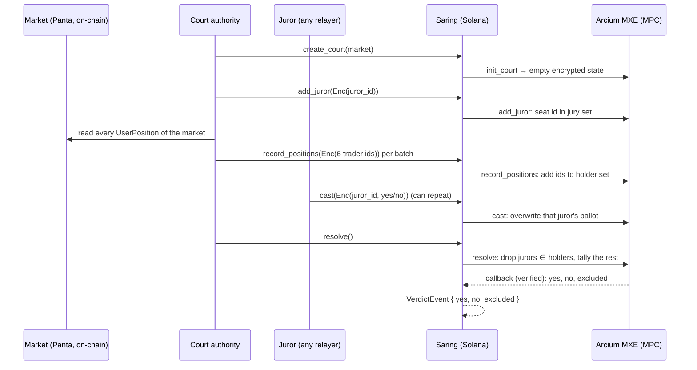

# Saring

**A conflict-blind jury for prediction-market disputes, on Solana with Arcium MPC.**

*Saring* is Indonesian for "filter". Jurors who hold a position in the disputed market are dropped silently. The chain only ever sees ciphertexts: not who sits on the jury, not who traded, and not which jurors were excluded. The MPC never reveals which jurors were excluded. (In this MVP the court authority seats the jurors and relays the positions, so it knows both lists. See [Limitations](#limitations-mvp-and-roadmap).) The only public output is `(yes, no, excluded)`.

Built for Colosseum's Crypto World's Fair (Sep 14 to Oct 12, 2026). MIT-licensed. Code identifiers still use the working name `blindcourt`.

- **Live on Solana devnet:** program [`3CeQ1DQYwXjNcr6hYwmACzUwyU1DNxWL9HtiCaVKyfHy`](https://explorer.solana.com/address/3CeQ1DQYwXjNcr6hYwmACzUwyU1DNxWL9HtiCaVKyfHy?cluster=devnet), Arcium MXE on devnet cluster offset 456 (see [Devnet](#devnet)).
- **Real Panta data:** the demo dispute is a real [Panta](https://panta.market) market. Its holders are read from Panta's program on Solana mainnet (see [Panta integration](#panta-integration)).
- **Conflict Report:** https://pugarhuda.github.io/saring/

---

## Why

When a prediction market is disputed, someone has to decide the outcome. On Polymarket that is UMA token voters. We matched every resolved UMA yes/no request on a Polymarket market since Jan 1, 2025 to the voters' Polymarket wallets (method and code in the [Conflict Report](https://pugarhuda.github.io/saring/)):

| Metric | Value |
|---|---|
| UMA disputes mapped to Polymarket markets | 4,093 |
| UMA voters who control a Polymarket wallet | 60.4% (3,742 of 6,197) |
| Disputes where at least one voter held a position in that market at vote time | 20.4% (834) |
| Same, markets with ≥ $1M volume | 65.7% (423 of 644) |
| Distinct conflicted voters, and the cost of their positions | 405 voters, ≈ $8.0M |
| **Outcomes that flip if conflicted voters are removed** | **0** |

Read this carefully. Conflicted voters did **not** change any outcome in this data, because their token weight was small. The point is that **nothing filters them**, and the numbers are a lower bound, since anyone can trade from a second wallet. Courts recuse conflicted judges even when they would have ruled correctly.

Why nobody filters: the obvious fix leaks. Publishing the jury tells bribers whom to pay. Publishing who holds positions doxxes traders. The check needs both lists and has to reveal neither, so it runs as a computation over two secret sets with no trusted coordinator. That is the job MPC does.

## How it works



**State.** Each dispute is a `CourtAccount` PDA (`["court", authority, id]`) holding one MXE-encrypted `Pack<[u32; 64]>`: 48 position-holder slots, 8 juror slots, and 8 ballot slots. It is stored as 11 ciphertexts that circuits read by byte offset. Every update runs inside MPC and writes back fresh ciphertexts and a nonce through a verified callback.

**Circuits** (`encrypted-ixs/src/lib.rs`). The compiled circuits are hosted off chain as GitHub release assets (`circuits-v2`). The program pins each one with a hash computed at build time, so a swapped circuit file doesn't match.

| Circuit | Does | Reveals |
|---|---|---|
| `init_court` | empty state | nothing |
| `add_juror` | seats an encrypted id in the first empty jury slot (authority only) | nothing |
| `record_positions` | adds up to 6 encrypted trader ids per call to the holder set, de-duplicated (authority only) | nothing |
| `cast` | writes or **overwrites** the ballot for that juror id | nothing |
| `resolve` | for each juror, checks membership in the holder set, then tallies only conflict-free ballots | `yes`, `no`, `excluded` |

**Receipt-free ballots.** Only a juror's last ballot counts, and `cast` can be submitted by any payer. A juror can show a briber a YES transaction and then quietly overwrite it. The briber can't tell.

**Demo scenario** (`tests/blindcourt.ts`). The dispute is a real Panta market: *"Will @debar be the outright winner of the NectarFi Frontier Traders Competition?"* (`3wdVRLDiMeuWRjGcFq2FZgAyCLhswTwNSKEHgNFRSZNB`).

- Every wallet with a position in that market (42 at the last run) is read from Solana mainnet and mirrored, encrypted, into the court.
- Five jurors are seated: 3 real holders of this market and 2 real Panta traders with no position in it.
- The 3 conflicted jurors vote YES. One clean juror is "bribed": he casts YES as a receipt, then re-casts NO. The other clean juror votes NO.
- A plain jury rules YES 4–1.
- Saring rules **yes=0, no=2, excluded=3**, and never reveals which three.

Honest caveat: the ballots are scripted, because we don't hold those wallets' keys. The positions and identities are real chain data.

## Panta integration

[`panta/panta.ts`](panta/panta.ts) reads Panta directly from its on-chain program on Solana mainnet (`balr_market`, `6gM5afTQBq5VZCfgpGqcsqzfWd5maLSCKWtGjbEobZMp`). There are no mocks or fixtures.

- **Holders of a market:** `getProgramAccounts` over Panta's `UserPosition` accounts (202 bytes), filtered by discriminator and by market at offset 9. Each account gives the owner (offset 41) and YES/NO shares (offsets 74 and 90). A position account that exists counts even if it is now empty, because a trader who exited still had a stake in the outcome.
- **Market question:** read from the market's `Event` account.
- **All Panta traders:** every `UserPosition` on the program (182 traders at the last run), used to pick clean jurors who have no position in the disputed market.
- **Identity:** `id = first 4 bytes of SHA-256(wallet pubkey)`, the same function for holders and jurors. It is encrypted client-side (x25519 + Rescue) before it reaches the chain.

We don't use a Panta API key. Panta's REST API has no endpoint that lists a market's holders, and the on-chain accounts are the source of truth anyway. `panta/check.ts` is a quick mainnet sanity check: it prints the question, holder and trader counts, and whether the identity ids are unique.

## Run it

Requirements: Linux or WSL2 with Docker running, **Arcium CLI 0.15.0**, **Anchor 1.0.2**, **Solana CLI 3.1.10**, Rust (pinned by `rust-toolchain.toml`), Node and Yarn. The test reads Panta from Solana mainnet. The public RPC works, and `MAINNET_RPC_URL` overrides it.

```bash
yarn install
arcium build          # compiles the Arcis circuits (build/*.arcis) and the Anchor program
arcium test           # starts an Arcium localnet (2 MPC nodes, Docker) and runs tests/blindcourt.ts
```

Expected output (abridged; holder and trader counts change as Panta trades):

```
Panta market 3wdVRLDiMeuWRjGcFq2FZgAyCLhswTwNSKEHgNFRSZNB: "Will @debar be the outright winner of the NectarFi Frontier Traders Competition?"
42 wallets hold a position; ... other Panta traders do not
court opened <court PDA>
5 jurors seated (encrypted)
42 Panta positions mirrored (encrypted)
ballots cast
verdict: yes=0 no=2 excluded=3
  ✔ excludes jurors who hold a position in a real Panta market, without revealing who
1 passing
```

Each instruction waits for its MPC computation to finalize, so a run takes several minutes. The test expects a keypair at `~/.config/solana/id.json`.

## Devnet

| | |
|---|---|
| Program | [`3CeQ1DQYwXjNcr6hYwmACzUwyU1DNxWL9HtiCaVKyfHy`](https://explorer.solana.com/address/3CeQ1DQYwXjNcr6hYwmACzUwyU1DNxWL9HtiCaVKyfHy?cluster=devnet) |
| Arcium MXE | devnet cluster offset **456**, Arcium 0.15.0 |
| Deploy tx | [`4bANmR3H…vdLDcV36`](https://explorer.solana.com/tx/4bANmR3HSzStMSo8z54RSBkh2YKDdQZPRT7kcfjYSLo6JWtvoXAshVwU8zWqQDFEQGLJc4Fmt6Lvqu5EvdLDcV36?cluster=devnet) |
| MXE init tx | [`dCSh4xpn…6iHtd`](https://explorer.solana.com/tx/dCSh4xpnt1FtZPwu4sSDezwBgVmre3hSqXYPJAxV84oQ3nSzHM23Y4tuieSXmqStGqAZys1xji1XVhrEwY6iHtd?cluster=devnet) |
| Circuits | GitHub release `circuits-v2` of this repo, pinned by hash |

All five computation definitions are initialized. To run the same Panta scenario against devnet (a fresh court id each run, so re-runs don't collide):

```bash
ANCHOR_PROVIDER_URL=https://api.devnet.solana.com \
ANCHOR_WALLET=~/.config/solana/id.json \
ARCIUM_CLUSTER_OFFSET=456 \
npx ts-mocha -p ./tsconfig.json -t 2000000 tests/blindcourt.ts
```

The wallet needs about 0.5 devnet SOL. The public devnet RPC rate-limits polling (HTTP 429), so a dedicated devnet RPC URL is more reliable.

## Web app

`app/` is a Vite + React + three.js front end. It reads the same Panta market from mainnet, shows the Conflict Report numbers, and runs the dispute step by step on devnet from a burner wallet, with an explorer link for every transaction. By default each juror's conflict status shows as "Encrypted". A "god view" toggle reveals which jurors hold the market, which the chain never sees. Run it with `cd app && yarn install && yarn dev`. See [`app/README.md`](app/README.md) for RPC settings. Hosted URL: **[TODO]**.

## Layout

```
encrypted-ixs/src/lib.rs        Arcis circuits (MPC side)
programs/blindcourt/src/lib.rs  Anchor program: court PDA, queue + callback per circuit
panta/panta.ts                  reads Panta markets, holders and traders from Solana mainnet
tests/blindcourt.ts             end-to-end Panta dispute (localnet or devnet)
app/                            web app (Vite + React + three.js), runs the dispute on devnet
conflict-report/                Conflict Report pipeline (Python) and site source
docs/                           published Conflict Report (GitHub Pages)
```

## Limitations (MVP) and roadmap

| Limitation today | Why it matters | Plan |
|---|---|---|
| The court authority seats jurors (`add_juror` is authority-only) | The authority knows the jury, so this is not yet bribe-resistant against the operator | Random selection inside MPC from a staked juror pool, and eligibility via **Solana Attestation Service** |
| The authority relays positions (`record_positions` is authority-only) by reading the market's chain state | Trust in the authority to mirror every holder; positions that open after the snapshot are missed | Market program calls it by **CPI on every fill**, gated to the market's program id |
| Ballots in the demo are scripted | We don't hold the real jurors' keys | Real jurors sign their own ballots in a pilot |
| Ids are `u32` and act as bearer secrets | Whoever learns a juror's id can cast for them, and a briber holding the id could cast last | **MACI-style key change**: ballots signed by a rotating per-juror key held in MXE state; u128 SAS-derived ids |
| Conflict = same id, wallet-level | Trading from a second wallet evades the filter (same lower-bound caveat as the data) | Key the check to an SAS identity so linked wallets count as one person; still not perfect |
| `excluded` count is public; jury ≤ 8, holders ≤ 48 | With tiny juries the count can leak who was excluded | Larger padded jury and holder sets; optionally reveal only the verdict |
| Positions read only for Solana markets | Polymarket positions live on Polygon, so live filtering doesn't apply to them | Solana-native venues first; cross-chain position attestations later |
| Sequential updates | Overlapping computations can race on the state nonce (inherited from the voting template) | Per-court queue or batching |
| No juror rewards, slashing, appeals | Not a full court yet | Fee from the losing dispute bond; appeal round with a larger jury |
| Devnet only | — | One pilot market with a venue, then an audit before mainnet |

Not audited. Don't use with real funds.

## Prior art

- **Kleros** randomly draws jurors from staked subcourts. Votes are hidden with Shutter threshold encryption, and there are appeal rounds. Jurors' identities are public on chain, and there is no check of whether a juror holds a position. Saring borrows the court model and adds the private conflict filter.
- **UMA DVM** uses commit-reveal voting weighted by UMA tokens, and it is the resolver for Polymarket. It has no conflict check. Our Conflict Report measures what this misses.
- **MACI** (Privacy & Scaling Explorations) gives receipt-free, collusion-resistant voting through key changes, but it relies on a trusted coordinator who can decrypt. Saring's overwritable ballots are the simple version of this idea. With Arcium the coordinator role is replaced by MPC. Full key-change is on the roadmap.
- **Arcium `examples/voting`**: this repo started from it (see below).

## Prior code and license

Forked from the `voting` example in [`arcium-hq/examples`](https://github.com/arcium-hq/examples/tree/main/voting) (commit `fe15384`). We kept the scaffolding and the comp-def, queue and callback pattern. We rewrote the circuits, the account layout, the instructions and the tests, and added the Panta reader, the web app and the Conflict Report. The examples repo has no LICENSE file, and `voting/package.json` declares ISC. This repo is MIT-licensed (see [LICENSE](LICENSE)).
