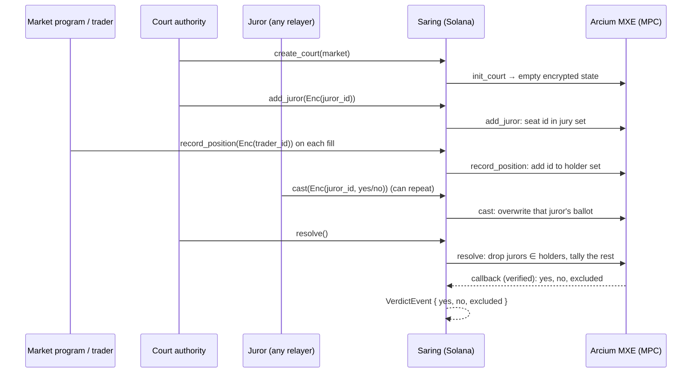

# Saring

**A conflict-blind jury for prediction-market disputes, on Solana with Arcium MPC.**

Jurors who hold a position in the disputed market are dropped silently. Nobody, including the court operator, learns who sat on the jury, who traded, or which jurors were excluded. The only public output is `(yes, no, excluded)`.

Built for Colosseum's Crypto World's Fair (Sep 14 to Oct 12, 2026).

---

## Why

When a prediction market is disputed, someone has to decide the outcome. On Polymarket that is UMA token voters. We matched every resolved UMA yes/no request on a Polymarket market since Jan 1, 2025 to the voters' Polymarket wallets (method and code in the [Conflict Report](https://pugarhuda.github.io/saring/)):

| Metric | Value |
|---|---|
| UMA disputes mapped to Polymarket markets | 4,093 |
| UMA voters who control a Polymarket wallet | 60.4% (3,742 of 6,197) |
| Disputes where at least one voter held a position in that market at vote time | 20.4% (834) |
| Same, markets with ≥ $1M volume | 65.7% (423 of 644) |
| Distinct conflicted voters, and the cost of their positions | 405 voters, ≈ $8.0M |
| **Outcomes that flip if conflicted voters are removed** | **0** |

Read this carefully. Conflicted voters did **not** change any outcome in this data, because their token weight was small. The point is that **nothing filters them**, and the numbers are a lower bound, since anyone can trade from a second wallet. Courts recuse conflicted judges even when they would have ruled correctly.

Why nobody filters: the obvious fix leaks. Publishing the jury tells bribers whom to pay. Publishing who holds positions doxxes traders. The check needs both lists and has to reveal neither, so it runs as a computation over two secret sets with no trusted coordinator. That is the job MPC does.

## How it works



**State.** Each dispute is a `CourtAccount` PDA (`["court", authority, id]`) holding one MXE-encrypted `Pack<[u32; 32]>`: 16 position-holder slots, 8 juror slots, and 8 ballot slots. It is stored as 6 ciphertexts that circuits read by byte offset. Every update runs inside MPC and writes back fresh ciphertexts and a nonce through a verified callback.

**Circuits** (`encrypted-ixs/src/lib.rs`):

| Circuit | Does | Reveals |
|---|---|---|
| `init_court` | empty state | nothing |
| `add_juror` | seats an encrypted id in the first empty jury slot | nothing |
| `record_position` | adds an encrypted trader id to the holder set (de-duplicated) | nothing |
| `cast` | writes or **overwrites** the ballot for that juror id | nothing |
| `resolve` | for each juror, checks membership in the holder set, then tallies only conflict-free ballots | `yes`, `no`, `excluded` |

**Receipt-free ballots.** Only a juror's last ballot counts, and `cast` can be submitted by any payer. A juror can show a briber a YES transaction and then quietly overwrite it. The briber can't tell.

**Demo scenario** (`tests/blindcourt.ts`). Market: "Did X happen by Oct 31?" The truth is NO. Five jurors are seated, and three of them (101 to 103) also traded the market and vote YES. Juror 104 is bribed: he casts YES as a "receipt" and then re-casts NO. Juror 105 votes NO.

- A plain jury rules YES 3–2 (4–1 if the bribe holds).
- Saring rules **yes=0, no=2, excluded=3**, and never reveals which three.

## Run it

Requirements: Linux or WSL2 with Docker running, **Arcium CLI 0.13.2**, **Anchor 1.0.2**, **Solana CLI 3.1.10**, Rust (pinned by `rust-toolchain.toml`), Node and Yarn.

```bash
yarn install
arcium build          # compiles the Arcis circuits (build/*.arcis) and the Anchor program
arcium test           # starts an Arcium localnet (2 MPC nodes, Docker) and runs tests/blindcourt.ts
```

Expected output (abridged):

```
court opened <court PDA>
5 jurors seated (encrypted)
5 positions recorded (encrypted)
ballots cast
verdict: yes=0 no=2 excluded=3
  ✔ excludes conflicted jurors without revealing who they are
1 passing
```

The localnet run takes a few minutes, because each instruction waits for its MPC computation to finalize. The test expects a keypair at `~/.config/solana/id.json`.

## Layout

```
encrypted-ixs/src/lib.rs        Arcis circuits (MPC side)
programs/blindcourt/src/lib.rs  Anchor program: court PDA, queue + callback per circuit
tests/blindcourt.ts             end-to-end scenario on Arcium localnet
```

## Limitations (MVP) and roadmap

| Limitation today | Why it matters | Plan |
|---|---|---|
| The court authority seats jurors (`add_juror` is authority-only) | The authority knows the jury, so this is not yet bribe-resistant against the operator | Random selection inside MPC from a staked juror pool, and eligibility via **Solana Attestation Service** |
| `record_position` is open to any signer | Anyone could mark a juror as conflicted (griefing) or skip recording | Market program calls it by **CPI on every fill**, gated to the market's program id |
| Ids are `u32` and act as bearer secrets | Whoever learns a juror's id can cast for them, and a briber holding the id could cast last | **MACI-style key change**: ballots signed by a rotating per-juror key held in MXE state; u128 SAS-derived ids |
| Conflict = same id, wallet-level | Trading from a second wallet evades the filter (same lower-bound caveat as the data) | Key the check to an SAS identity so linked wallets count as one person; still not perfect |
| `excluded` count is public; jury ≤ 8, holders ≤ 16 | With tiny juries the count can leak who was excluded | Larger padded jury and holder sets; optionally reveal only the verdict |
| Positions recorded only for Solana markets | Polymarket positions live on Polygon, so live filtering doesn't apply to them | Solana-native venues first; cross-chain position attestations later |
| Sequential updates | Overlapping computations can race on the state nonce (inherited from the voting template) | Per-court queue or batching |
| No juror rewards, slashing, appeals | Not a full court yet | Fee from the losing dispute bond; appeal round with a larger jury |
| Localnet only | — | Devnet deploy, then one pilot market |

Not audited. Don't use with real funds.

## Prior art

- **Kleros** randomly draws jurors from staked subcourts. Votes are hidden with Shutter threshold encryption, and there are appeal rounds. Jurors' identities are public on chain, and there is no check of whether a juror holds a position. Saring borrows the court model and adds the private conflict filter.
- **UMA DVM** uses commit-reveal voting weighted by UMA tokens, and it is the resolver for Polymarket. It has no conflict check. Our Conflict Report measures what this misses.
- **MACI** (Privacy & Scaling Explorations) gives receipt-free, collusion-resistant voting through key changes, but it relies on a trusted coordinator who can decrypt. Saring's overwritable ballots are the simple version of this idea. With Arcium the coordinator role is replaced by MPC. Full key-change is on the roadmap.
- **Arcium `examples/voting`**: this repo started from it (see below).

## Prior code and license

Forked from the `voting` example in [`arcium-hq/examples`](https://github.com/arcium-hq/examples/tree/main/voting) (commit `fe15384`). We kept the scaffolding and the comp-def, queue and callback pattern. We rewrote the circuits, the account layout, the instructions and the tests. The examples repo has no LICENSE file, and `voting/package.json` declares ISC. This repo is MIT-licensed (see LICENSE).
